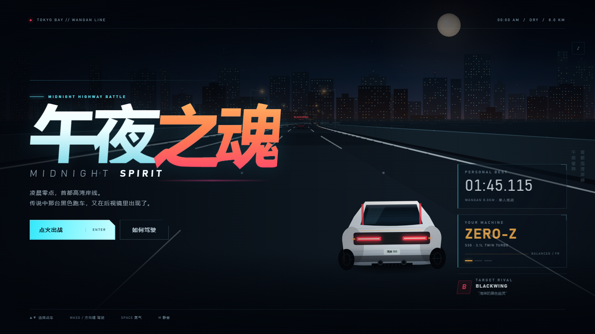
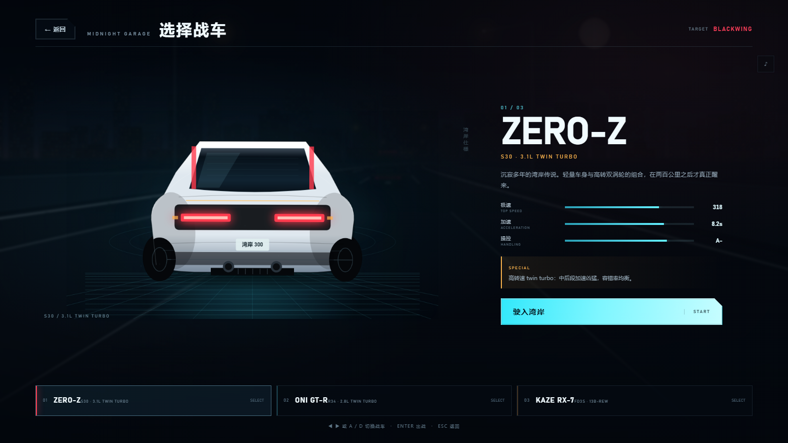
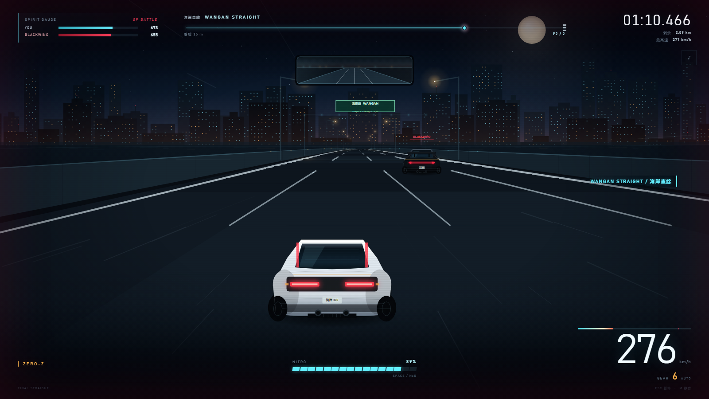
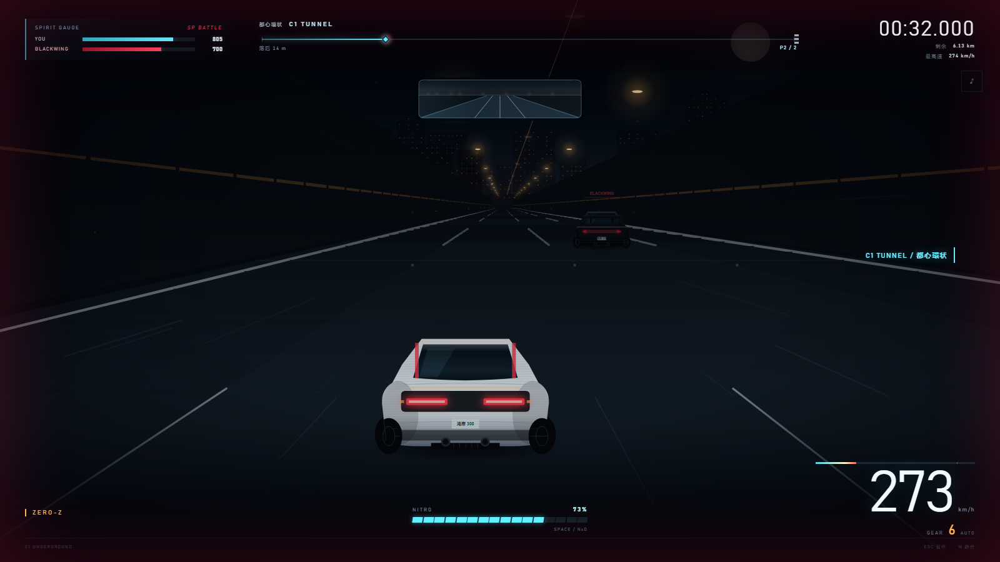
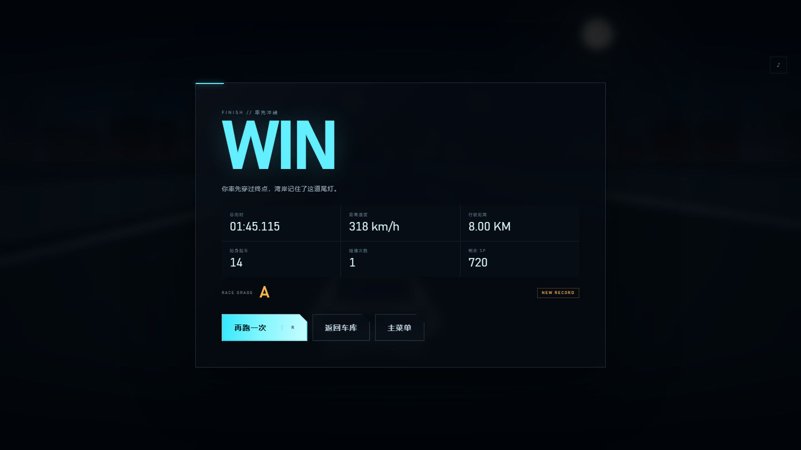
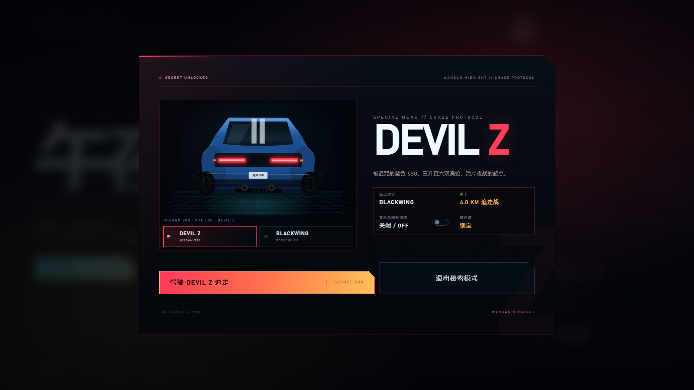
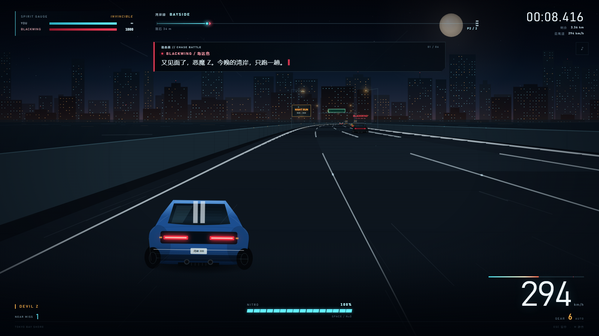
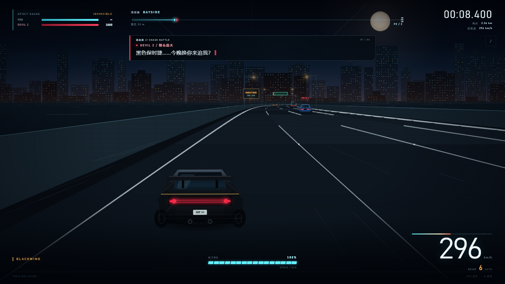
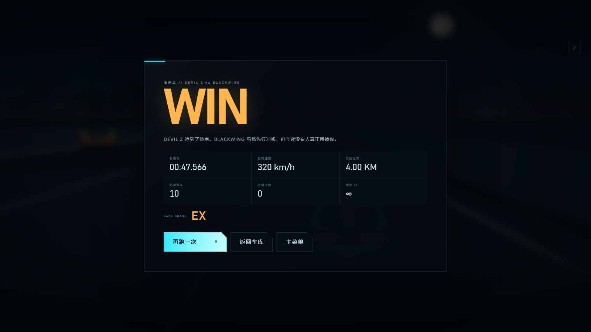

# 午夜之魂 / MIDNIGHT SPIRIT

**A 2D third-person night-highway racing game inspired by Wangan Midnight.**
**一款受《湾岸 Midnight》玩法启发的 2D 第三人称首都高夜战赛车游戏。**

纯 HTML + CSS + Canvas 2D 实现，无构建步骤、无外部依赖、无联网请求，双击即玩。



## 启动方式

- **Windows**：双击 `启动游戏.bat`，或直接双击 `index.html`。
- **其他系统**：用 Chrome / Edge / Firefox / Safari 打开 `index.html`。
- 推荐 16:9 窗口、开启声音；手机可横屏游玩，已适配触控按键。

## 操作

| 按键 | 功能 |
| --- | --- |
| `W` / `↑` | 油门 |
| `S` / `↓` | 刹车 |
| `A` `D` / `←` `→` | 转向 |
| `Space` | 氮气加速 |
| `Esc` / `P` | 暂停 |
| `M` | 静音 |
| `Enter` | 确认 / 出战 |
| `R` | 结算界面再跑一次 |

手机端会显示触控方向盘、刹车、氮气与油门按钮。车库左右两侧的 `‹` `›` 可切换战车。

## 核心玩法

- 与黑色幽灵 **BLACKWING** 在首都高湾岸线进行 1v1 夜战，全程 **8.0 KM**。
- **SP 精神值**：贴身缠斗时，落后的一方会持续损失 SP；撞上民用车、刮蹭护栏同样会掉 SP。任一方 SP 归零即分出胜负。
- **氮气**：按住 `Space` 消耗氮气，最高可突破表显极速；贴近车流完成擦身超车会回复少量氮气。
- **获胜条件**：率先冲过终点，或把对手的 SP 压到零。
- **评价**：根据完赛时间、碰撞次数、贴身超车与剩余 SP 给出 S / A / B / C 评级，并记录本地最佳成绩。

## 三台可选战车

| 车型 | 特性 | 极速 |
| --- | --- | --- |
| **ZERO-Z** S30 | 均衡、后段涡轮爆发 | 318 km/h |
| **ONI GT-R** R34 | 四驱、加速和极速最强，手感偏重 | 327 km/h |
| **KAZE RX-7** FD3S | 轻量转子、转向最灵敏 | 306 km/h |



## 场景与细节

- 伪 3D 透视的四车道湾岸线，带弯道、坡度、路肩、护栏和车道反光钉。
- 三个区域各有独立氛围：**湾岸线 / C1 隧道 / 彩虹桥 / 最终直线**。
- 动态车流（轿车、厢式车、卡车、出租车、跑车）、后视镜、路灯、霓虹广告牌、门架与终点棋盘门。
- 全程序化 WebAudio：引擎声、风噪、撞击、氮气、倒计时提示音，以及一段 synthwave 循环。
- 支持桌面键盘、移动端触控、暂停、静音、本地最佳成绩。







## 隐藏内容（剧透）

<details>
<summary>点击展开秘密菜单的进入方式</summary>

在主菜单依次输入 **`WANGAN MIDNIGHT`**（不区分大小写）。

输入正确后会开启秘密模式：

- **车辆选择界面**：可选 **DEVIL Z（日产 S30 / 恶魔 Z）** 或 **BLACKWING（保时捷 911）**
- 选择 DEVIL Z 时，追走战对手为 **BLACKWING**
- 选择 BLACKWING 时，追走战对手切换为 **DEVIL Z**
- 关卡为 **4.0 KM 追走战**：玩家从目标车后方起跑，追走至终点
- 画面顶部会出现《湾岸 Midnight》风格的剧情对话框，交替显示两名车手的台词；选择哪台车，就以哪位车手的视角说话
- 所有交通车辆默认取消碰撞箱，可从车流中直接穿过；秘密菜单内可用 **「其他车辆碰撞箱」** 开关切换回实体碰撞（开启后仍保持 SP 锁定）
- 玩家 SP 锁定为满值，不再受到撞车 / 刮墙伤害
- 败北条件解除：即使对手先冲线，也仍可继续跑完并结算
- 秘密比赛成绩不写入普通最佳纪录，结算评级为 **EX**

> 剧情台词为原创致敬文本，保留两名车手在湾岸夜战中的语气，并非漫画 / 动画原文的直接引用。









</details>

## 文件结构

```text
midnight-spirit/
├─ index.html           页面与界面结构
├─ styles.css           视觉样式 / HUD / 移动端适配
├─ game.js              路线、物理、AI、渲染、音频、流程
├─ 启动游戏.bat         Windows 一键启动
├─ README.md
├─ .gitignore
├─ .gitattributes
├─ .nojekyll            GitHub Pages 静态站点标记
└─ screenshots/         游戏截图
```

## 发布到 GitHub

### 方式一：命令行推送

```bash
cd midnight-spirit
git init
git add .
git commit -m "feat: Midnight Spirit 2D racing game"
git branch -M main
git remote add origin https://github.com/<你的用户名>/midnight-spirit.git
git push -u origin main
```

如果这是你第一次使用 Git，提交前需要先配置身份：

```bash
git config --global user.name "你的名字"
git config --global user.email "你的邮箱"
```

### 方式二：直接上传

在 GitHub 新建仓库后，把 `midnight-spirit` 文件夹里的全部文件拖入上传，注意保留 `screenshots/` 目录。

### 开启 GitHub Pages

仓库 **Settings → Pages → Build and deployment**：

- Source 选择 `Deploy from a branch`
- Branch 选择 `main`，目录选择 `/(root)`
- 保存后访问 `https://<你的用户名>.github.io/midnight-spirit/`

游戏全部路径都是相对路径，可直接运行在 GitHub Pages 上。

## 版权与同人声明

- 本作是**非商业同人致敬作品**，与《湾岸 Midnight》的版权方无关联。
- 作品中出现的《湾岸 Midnight》、**DEVIL Z**、**BLACKWING** 及角色名称等，权利归原作者楠みちはる及相关权利方所有。
- 本项目未使用原作漫画、动画、游戏的美术、音频或代码素材；画面、程序音频与代码均为本项目原创实现。
- 剧情对话为原创致敬文本，并非漫画 / 动画原文引用。
- 当前仓库未附带开源许可证（LICENSE）。发布前请根据自己的意愿选择许可证；如果不希望他人复用，请保留默认的 All rights reserved。
